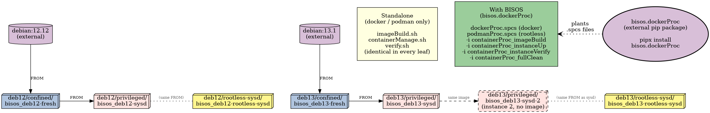

#+TITLE: bro_dockerfiles --- Debian VNC/XFCE Container Images, Standalone or With BISOS
#+DATE: <2026-08-07 Thu>
#+AUTHOR: Mohsen BANAN
#+OPTIONS: toc:4

This repo specifies Debian container images that give you an XFCE4 desktop over VNC and noVNC,
plus sshd, for Debian 12 (Bookworm) and Debian 13 (Trixie). It is a BRO (BISOS Repo Object), but
*you do not need BISOS to use it*: every image can be built, run and verified with nothing but
docker (or podman) and the scripts in its directory.

It is also an *integral part of BISOS*. With =bisos.dockerProc=, its leaves are the test matrix of
RawBisos-Reconstruction, BISOS's CI/CD: one walk over the tree builds the images, creates fresh
instances, bootstraps BISOS inside them from =bxGenesis/start= and verifies the result (see
[[#rawbisos-reconstruction-bisoss-cicd][RawBisos-Reconstruction]]).

Images are organized along an *init/isolation profile* dimension --- three peers describing how
the container is initialized and how much privilege it holds:

- *confined* :: Unprivileged containers. No systemd. VNC/noVNC/sshd started
  directly via =entrypoint.sh=. Safe to run anywhere; cgroup-version-agnostic.

- *privileged* :: Full =--privileged= containers (Docker) with systemd as
  PID 1. VNC/noVNC/sshd managed as systemd units. Socket activation works.
  Behaves as close to a VM as possible. Intended for trusted dev environments.

- *rootless-sysd* :: Same systemd-as-PID-1 image, but run under *rootless
  Podman* --- systemd fidelity *with* the unprivileged/userspace security
  posture (no =--privileged=). Requires a *cgroup v2* host. Intended for
  multi-tenant use (N engineers on one shared host).

The three peers are named by property, not by tool. See
[[#host-compatibility-cgroup-v1-vs-v2][Host Compatibility]] for which profile works on which host.

* Two Ways to Use This Repo

Every leaf directory (one image, or one instance of an image) can be used in two ways. They use the
same =Dockerfile=, the same compose or Quadlet files, the same names and ports, and produce the
same image and container. Neither is a fallback for the other; both are permanent and kept at
parity.

|           | *Standalone*                                       | *With BISOS*                            |
|-----------+----------------------------------------------------+-----------------------------------------|
| Needs     | docker + compose, or podman                        | BISOS + =pipx install bisos.dockerProc= |
| Per leaf  | =imageBuild.sh=  =containerManage.sh=  =verify.sh= | =dockerProc.spcs= / =podmanProc.spcs=   |
| Gives you | build, run, stop, delete, verify each leaf         | the same, as =containerProc_*= commands |
| Adds      | ---                                                | one command over many leaves (walker),  |
|           |                                                    | Raw-BISOS reconstruction, host checks,  |
|           |                                                    | (planned) a port/subnet registrar       |
| Hosts     | cgroup v2, and cgroup v1 (not rootless-sysd)       | cgroup v2 only                          |
| Ignore    | =*.spcs=, =_nodeBase_/=, =_tree_=, =_treeProc_=    | ---                                     |

Standalone use is described in [[#standalone-use][Standalone Use]] below and in each leaf's
=README.org=; BISOS use in [[#use-with-bisos][Use With BISOS]].

Standalone is the only way on hosts where BISOS cannot be installed (for example old RedHat VMs),
and the simplest way anywhere.

The command each way uses for the same task:

| Task                 | Standalone                                       | With BISOS (=./dockerProc.spcs -i ...=)           |
|----------------------+--------------------------------------------------+---------------------------------------------------|
| Build the image      | =./imageBuild.sh=                                | =containerProc_imageBuild=                        |
| Create the container | =./containerManage.sh create=                    | =containerProc_instanceUp= (also starts)          |
| Start                | =./containerManage.sh start=                     | =containerProc_instanceUp=                        |
| Stop                 | =./containerManage.sh stop=                      | =containerProc_instanceDown=                      |
| Restart              | =./containerManage.sh restart=                   | =containerProc_instanceRestart=                   |
| Delete the container | =./containerManage.sh delete=                    | =containerProc_instanceDelete=                    |
| Status               | =./containerManage.sh status=                    | =containerProc_instanceStatus=                    |
| Verify (sysd leaves) | =./verify.sh=                                    | =containerProc_instanceVerify=                    |
| VNC password         | =./containerManage.sh vncPassword set= (=clear=) | =containerProc_instanceVncPassword set= (=clear=) |

* Quick Start (Standalone)

#+BEGIN_SRC bash
git clone https://github.com/bxObjects/bro_dockerfiles.git
cd bro_dockerfiles/debian/13/confined/vnc/xfce/bisos_deb13-fresh
./imageBuild.sh                    # build the image (docker)
./containerManage.sh create        # checks name, ports and image first
./containerManage.sh start
#+END_SRC

Then point a VNC client at =localhost:5907=, or a browser at =http://localhost:6907/=, or
=ssh -p 2228 bystar@localhost= (password =insecure=). For a systemd image, build its confined base
first, then do the same in its leaf, e.g. =debian/13/privileged/vnc/xfce/bisos_deb13-sysd/=.
Each leaf's =README.org= has its own first run.

* Table of Contents     :TOC:
- [[#two-ways-to-use-this-repo][Two Ways to Use This Repo]]
- [[#quick-start-standalone][Quick Start (Standalone)]]
- [[#the-repo-at-a-glance][The Repo at a Glance]]
- [[#structure-of-this-repo][Structure of This Repo]]
- [[#images][Images]]
  - [[#confined][Confined]]
  - [[#privileged][Privileged]]
  - [[#rootless-sysd][Rootless-sysd]]
- [[#host-compatibility-cgroup-v1-vs-v2][Host Compatibility (cgroup v1 vs v2)]]
- [[#host-os--podman-version-for-rootless-sysd-debian-12-vs-13][Host OS / Podman Version for rootless-sysd (Debian 12 vs 13)]]
- [[#feature-parity-privileged-vs-rootless-sysd][Feature Parity: privileged vs rootless-sysd]]
- [[#standalone-use][Standalone Use]]
  - [[#the-leaf-scripts][The Leaf Scripts]]
  - [[#building][Building]]
  - [[#running][Running]]
  - [[#ports-and-subnets][Ports and Subnets]]
  - [[#connecting-to-a-container][Connecting to a Container]]
  - [[#checking-a-host-for-rootless-podman][Checking a Host for Rootless Podman]]
- [[#common-to-both-ways][Common to Both Ways]]
  - [[#local-only-images][Local-only Images]]
  - [[#running-inside-a-container-is-refused][Running Inside a Container Is Refused]]
  - [[#installing-raw-bisos-inside-a-container][Installing Raw-BISOS Inside a Container]]
- [[#use-with-bisos][Use With BISOS]]
  - [[#one-leaf-the-planted-spcs][One Leaf: the Planted =.spcs=]]
  - [[#walking-the-tree-lifecycle-verbs][Walking the Tree: Lifecycle Verbs]]
  - [[#rawbisos-reconstruction-bisoss-cicd][RawBisos-Reconstruction: BISOS's CI/CD]]
  - [[#related-pieces][Related Pieces]]
  - [[#architectural-context][Architectural Context]]
- [[#prior-and-similar-art][Prior and Similar Art]]
- [[#related-resources][Related Resources]]

* The Repo at a Glance

The figure shows the leaves, their =FROM= inheritance, and the two ways to use each leaf.

*Legend:*

| Element                        | Meaning                                                       |
|--------------------------------+---------------------------------------------------------------|
| Thistle cylinder (top)         | External Debian base image, pulled from Docker Hub.           |
| Light-blue leaf (=box3d=)      | *confined* leaf --- unprivileged docker, no systemd.          |
| Pink leaf (=box3d=)            | *privileged* leaf --- docker =--privileged=, systemd PID 1.   |
| Pink dashed leaf               | A further *instance* of a privileged image (no own image).    |
| Khaki leaf (=box3d=)           | *rootless-sysd* leaf --- rootless podman, systemd PID 1.      |
| =FROM= arrow                   | Image inheritance: confined from Debian, sysd from confined.  |
| =(same FROM)= dotted connector | Privileged and rootless-sysd of a release share their base.   |
| =same image= dashed arrow      | The primary leaf whose image a numbered instance runs.        |
| Yellow rectangle               | *Standalone* --- the leaf scripts; docker / podman only.      |
| Green rectangle                | *With BISOS* --- the planted =.spcs= of =bisos.dockerProc=.   |
| Thistle ellipse (right)        | =bisos.dockerProc= --- the pip package providing the =.spcs=. |

Within each release, the privileged and rootless-sysd images are both built =FROM= the confined
image, so *the confined image is built first*. Both ways apply to every leaf.

* Structure of This Repo

#+BEGIN_SRC
debian/
  <majorRelease>/
    confined/vnc/xfce/<leafName>/
    privileged/vnc/xfce/<leafName>/
    rootless-sysd/vnc/xfce/<leafName>/
common/raw-bisos/            # the Raw-BISOS payload baked into the confined images
figures/                     # the figure above
#+END_SRC

| Leaf                        | Release | Profile       | =FROM=                     | Engine               |
|-----------------------------+---------+---------------+----------------------------+----------------------|
| =bisos_deb12-fresh=         |      12 | confined      | =debian:12.12=             | docker, unprivileged |
| =bisos_deb12-sysd=          |      12 | privileged    | =bisos_deb12-fresh:latest= | docker, privileged   |
| =bisos_deb12-rootless-sysd= |      12 | rootless-sysd | =bisos_deb12-fresh:latest= | podman, rootless     |
| =bisos_deb13-fresh=         |      13 | confined      | =debian:13.1=              | docker, unprivileged |
| =bisos_deb13-sysd=          |      13 | privileged    | =bisos_deb13-fresh:latest= | docker, privileged   |
| =bisos_deb13-sysd-2=        |      13 | privileged    | (runs =bisos_deb13-sysd=)  | docker, privileged   |
| =bisos_deb13-rootless-sysd= |      13 | rootless-sysd | =bisos_deb13-fresh:latest= | podman, rootless     |

A leaf is at =debian/<release>/<profile>/vnc/xfce/<leaf>/=. Its local image is =<leaf>:latest=;
confined images run =entrypoint.sh=, the others systemd as PID 1.

The privileged and rootless-sysd images share an identical
build; they differ only at run time (=--privileged= + cgroup mounts vs. rootless Podman's native
systemd integration).

*A numeric suffix means a shared image.* A leaf named =<primary>-<N>= (e.g.
=bisos_deb13-sysd-2=) is instance =N= of the image of =../<primary>=: its compose files name the
primary's image and have no =build:= section, and its =imageBuild.sh= builds nothing (it prints
the primary's build command). It has its own container name, host ports and cgroup v1 subnet.

Each leaf directory contains:

| File/Dir                  | Used by    | Purpose                                                    |
|---------------------------+------------+------------------------------------------------------------|
| =README.org=              | both       | This leaf: its image, both ways of use, its ports          |
| =Dockerfile=              | both       | The image; its =LABEL= names the DockerHub image           |
| =docker-compose.yml=      | both       | (docker leaves) privileged: cgroup v2; confined: either    |
| =docker-compose.cgv1.yml= | both       | (privileged) the cgroup v1 variant                         |
| =*.container=             | both       | (rootless-sysd) Podman Quadlet unit: container name, ports |
| =dockerConf/=             | both       | Copied into the image: entrypoint + XFCE files, or units   |
| =verify.sh=               | both       | (sysd) host-side smoke test of a running container         |
| =imageBuild.sh=           | standalone | Build the image (=-u= also pushes multi-arch to DockerHub) |
| =containerManage.sh=      | standalone | create / start / stop / restart / delete / status          |
| =dockerProc.spcs=         | BISOS      | (docker leaves) planted command of =bisos.dockerProc=      |
| =podmanProc.spcs=         | BISOS      | (rootless-sysd) planted command of =bisos.dockerProc=      |
| =_nodeBase_/=             | BISOS      | The leaf's Blee panel                                      |
| =raw-bisos/=              | both       | (confined; not in git) copied from =common/raw-bisos/=     |

Branch directories (=debian/=, =debian/<release>/=, the profile directories) hold only BISOS
files: =ftoBranchProc.spcs= and, in some, =_tree_= / =_treeProc_= markers.

* Images

** Confined

No systemd. Services started by =entrypoint.sh=, container stays alive via
=sleep infinity=. Can run on any Docker host without special privileges.

The =bystar= user is created with home directory mode *755* (overriding the
=useradd= default of 700 from =/etc/login.defs=). The privileged and
rootless-sysd images inherit this via their =FROM= base.

| Local image                | Debian | DockerHub name (for =-u=)         |
|----------------------------+--------+-----------------------------------|
| =bisos_deb12-fresh:latest= |  12.12 | =bisos/deb12-fresh-vnc-xfce:1.21= |
| =bisos_deb13-fresh:latest= |   13.1 | =bisos/deb13-fresh-vnc-xfce:4=    |

** Privileged

systemd as PID 1. Full socket activation, timers, journald, =systemctl= all
work. Requires Docker Engine. Runs on cgroup v2 hosts with =docker-compose.yml= and on cgroup v1
hosts with =docker-compose.cgv1.yml= (see [[#host-compatibility-cgroup-v1-vs-v2][Host Compatibility]]).
Intended for trusted dev environments.

| Local image               | DockerHub name (for =-u=)     |
|---------------------------+-------------------------------|
| =bisos_deb12-sysd:latest= | =bisos/deb12-sysd-vnc-xfce:1= |
| =bisos_deb13-sysd:latest= | =bisos/deb13-sysd-vnc-xfce:1= |

*Docker tmpfs and =/tmp=.* Docker's =tmpfs:= shorthand mounts =/tmp= with =noexec=
by default --- unlike Debian's own =/tmp= which is exec. The privileged images
include a =tmp-exec.service= systemd oneshot that runs =mount -o remount,exec /tmp=
early at boot (after =local-fs.target=, before =sysinit.target=), restoring
Debian's default behaviour. The confined images are not affected (their =/tmp= is
on the container's overlayfs root, not a Docker tmpfs mount).

** Rootless-sysd

The same systemd image as privileged, but run under *rootless Podman* --- no
=--privileged=, no host =/sys/fs/cgroup= bind mount. Podman's native systemd
integration (=--systemd=always=) does the cgroup subtree delegation and tmpfs
plumbing inside the launching user's namespace. Container root maps to the
engineer's unprivileged host UID. *Requires a cgroup v2 host with delegation.*

| Local image                        | DockerHub name (for =-u=)              |
|------------------------------------+----------------------------------------|
| =bisos_deb12-rootless-sysd:latest= | =bisos/deb12-rootless-sysd-vnc-xfce:1= |
| =bisos_deb13-rootless-sysd:latest= | =bisos/deb13-rootless-sysd-vnc-xfce:1= |

Host prerequisites (Debian): =podman crun uidmap fuse-overlayfs
dbus-user-session slirp4netns passt=. Enable cgroup v2 controller delegation
for the user session (=Delegate=cpu io memory pids= drop-in on
=user@.service=). See [[#checking-a-host-for-rootless-podman][Checking a Host for Rootless Podman]].

*Two run forms for the same image:* =containerManage.sh= drives =podman create/start/stop/rm=
directly, for the leaf's own instance; the Quadlet =*.container= unit is the *persistent,
per-engineer* form (=systemctl --user start/enable= + =loginctl enable-linger=)
for the multi-tenant "N engineers on one host" model --- it survives logout and
starts at login/boot. They use the same container name, so use one or the other.

Rootless Podman needs a real user session --- log in as the user directly
(not =su=), or crun's systemd cgroup manager fails with an
=sd-bus ... Input/output error=.

* Host Compatibility (cgroup v1 vs v2)

Which profile works depends on the *host* cgroup version. You cannot switch
v1 <-> v2 at runtime (it is chosen at boot). Check with:

#+BEGIN_SRC bash
stat -fc %T /sys/fs/cgroup      # cgroup2fs = v2 ; tmpfs = v1/hybrid
#+END_SRC

| Profile         | cgroup v1 host (standalone only)            | cgroup v2 host |
|-----------------+---------------------------------------------+----------------|
| confined        | works                                       | works          |
| privileged sysd | works via =docker-compose.cgv1.yml=         | works (=.yml=) |
| rootless-sysd   | *does not work* (no v1 rootless delegation) | works          |

=containerManage.sh= reads the host's cgroup version and picks the matching compose file itself;
on a cgroup v1 host it refuses the rootless-sysd leaves. *With BISOS, cgroup v1 is not
supported*: =bisos.dockerProc= treats it as obsolete and its commands refuse a cgroup v1 host, so
on such a host use the standalone scripts. The =docker-compose.cgv1.yml= files exist for the
standalone way only.

Notes:
- *rootless-sysd requires cgroup v2.* cgroup v1 has no safe delegation model,
  so rootless systemd-as-PID-1 and rootless resource limits do not work.
- *privileged sysd works on v1* with =docker-compose.cgv1.yml=: it mounts =/sys/fs/cgroup:ro= +
  =/sys/fs/cgroup/systemd:rw=, omits =cgroup: host=, and gives the container its own bridge
  network on an explicit subnet (hosts whose default docker address pools are exhausted). Still
  needs =--privileged=.
- *RHEL 8* defaults to v1/hybrid; flip with
  =grubby --update-kernel=ALL --args="systemd.unified_cgroup_hierarchy=1"= +
  reboot. If the host cannot be rebooted, use the v1 file (privileged) or
  provision a fresh v2 instance (RHEL 9 / Amazon Linux 2023 default to v2).

* Host OS / Podman Version for rootless-sysd (Debian 12 vs 13)

The rootless-sysd variant's smoothness depends on the *host's* Podman/crun
version, which tracks the host Debian release. (The container is Debian 12/13
either way; this is about the machine running podman.)

| Host      | Podman | rootless-sysd experience                           |
|-----------+--------+----------------------------------------------------|
| Debian 12 |  4.3.1 | works, with two old-Podman bugs accommodated below |
| Debian 13 |  5.4.2 | clean --- the accommodations are unnecessary       |

On a *Debian 12 host* (older Podman/crun) two bugs surface; both are worked
around in this repo so it still functions:
- *Build:* buildah's per-RUN transient scope fails with
  =sd-bus ... org.freedesktop.systemd1 ... Input/output error=. =imageBuild.sh=
  passes =--isolation=chroot= to sidestep it (image layers are identical).
- *Runtime:* =podman exec= into the systemd container fails with a nested
  =cgroup.procs= "Permission denied". So =verify.sh= is *exec-free* (host-side
  checks + an SSH session), and you manage the container over SSH, not exec.

On a *Debian 13 host* (Podman 5.4.2) both are fixed: =--isolation=chroot= is
unnecessary (but harmless) and =podman exec= works. The workarounds are kept
so the *same scripts run unchanged* on a Debian 12 or 13 host.

Requirements that apply on *both* (not Podman-version issues):
- cgroup v2 host with controller delegation (rootless needs it).
- a real user *login* session (not =su=) + =loginctl enable-linger= for the
  persistent Quadlet per-engineer model.
- Podman store (graphroot) on a large *local* disk --- not =/= if it is
  near-full, and never NFS (overlay is unreliable on NFS). Set via
  =~/.config/containers/storage.conf=.
- =polkit.service= is masked in the sysd images: it fails inside the Debian
  guest (no seat/session) and would otherwise leave systemd =degraded=,
  regardless of host.

* Feature Parity: privileged vs rootless-sysd

Setting aside the security and multi-tenant differences: both are
systemd-PID-1 containers, so *all systemd service-management features are
identical* between them. They diverge only for workloads that reach through
the container into the host *kernel/hardware* --- exactly what =--privileged=
unlocks and a rootless user namespace cannot grant.

*Identical in both* (no functional difference): systemd units + dependency
ordering + =Restart=, *socket activation* (=.socket= units, e.g. nginx/Django),
timers, journald, CPU/memory/PID resource limits, running servers/DBs/web apps
(Airflow, Postgres, nginx, gunicorn/uvicorn), Unix sockets, tmpfs on =/run=,
binding low ports *inside* the container.

*Works in privileged, fails/limited under rootless-sysd:*

| Capability a service might need                                 | privileged | rootless-sysd                                |
|-----------------------------------------------------------------+------------+----------------------------------------------|
| Load kernel modules (=modprobe=)                                | yes        | no (hard wall)                               |
| Mount real/loop/block filesystems; =.mount=/automount units     | yes        | no (tmpfs/bind/fuse only)                    |
| systemd =RootImage=/=MountImage=/portable services              | yes        | no                                           |
| Create/access device nodes (=mknod=, raw disk, GPU)             | yes        | no                                           |
| =/dev/kvm= nested VMs, =/dev/net/tun= kernel VPNs               | yes        | only if device explicitly passed + permitted |
| Write =sysctl= / =/proc/sys= (e.g. =ip_forward=)                | yes        | no (mostly read-only)                        |
| Kernel networking: bridges, NAT, nftables modules, networkd     | yes        | limited (slirp4netns/pasta userns)           |
| Set the system clock (=settimeofday=/timesyncd stepping)        | yes        | no (hard wall)                               |
| Device cgroup (=DeviceAllow=) and block-I/O limits (=IOWeight=) | yes        | no (controllers not delegated)               |
| Write to =/sys= (hardware/kernel knobs)                         | yes        | no (mostly read-only)                        |
| Docker-in-Docker / full nested runtimes                         | yes        | heavily constrained                          |

Nuance: some rootless gaps can be selectively re-opened by the host
(=--device=, =--cap-add=, =--sysctl=, device-group membership); others can
*never* be granted to a rootless user (kernel modules, =settimeofday=, mounting
arbitrary block devices).

*Rule of thumb:* userland + systemd → both are equal; needs the kernel to do
something privileged on real hardware → only the privileged image can.

* Standalone Use

Needs nothing but docker and compose (the =docker compose= plugin or the older =docker-compose=
binary), or podman for the rootless-sysd leaves. No BISOS, no pip install. Each leaf's
=README.org= describes that leaf's use in full; this section is the overview.

** The Leaf Scripts

=imageBuild.sh= and =containerManage.sh= are *identical in every leaf*: copy them, never edit one
leaf's copy. They derive everything from the leaf:
- the path gives the image name (the leaf name) and the engine (podman for rootless-sysd, else
  docker);
- the =Dockerfile= gives the base image (=FROM=), the Raw-BISOS step (=COPY ./raw-bisos=) and the
  DockerHub name (=LABEL=);
- the compose files (docker) or the Quadlet file (podman) give the container name, the host ports
  and the cgroup v1 subnet.

Both run from any directory (they =cd= to their leaf). =verify.sh= is per profile: it carries
its leaf's default container name and ports.

** Building

Build the confined image of a release first; the privileged and rootless-sysd images are built
=FROM= it.

#+BEGIN_SRC bash
cd debian/12/confined/vnc/xfce/bisos_deb12-fresh
./imageBuild.sh          # local build (docker); copies common/raw-bisos into the build context

cd ../../../../privileged/vnc/xfce/bisos_deb12-sysd
./imageBuild.sh          # stops, with the confined leaf's command, if the base is missing

cd ../../../../rootless-sysd/vnc/xfce/bisos_deb12-rootless-sysd
./imageBuild.sh          # podman; builds the confined base into podman's store if missing
#+END_SRC

=-n= bypasses the layer cache. Same pattern for Debian 13 under =debian/13/=.

** Running

The same commands in every leaf (any profile, either engine):

#+BEGIN_SRC bash
cd debian/12/privileged/vnc/xfce/bisos_deb12-sysd
./containerManage.sh -n create    # dry run: checks only, prints the commands
./containerManage.sh create       # refuses if the container exists, a port or the subnet is taken,
                                  # or the image is not built
./containerManage.sh start
./verify.sh                       # sysd leaves
./containerManage.sh status       # also: stop, restart, delete, vncPassword set|clear
#+END_SRC

=containerManage.sh= picks what to run from the leaf and the host: docker compose with
=docker-compose.yml= (cgroup v2) or =docker-compose.cgv1.yml= (cgroup v1) for the privileged
leaves, the one =docker-compose.yml= for the confined leaves, and rootless =podman create
--systemd=always= (cgroup v2 only) for the rootless-sysd leaves.

The leaf directory is mounted into the container at =/shuttle/this=. After a
container is up, =./verify.sh= (in each sysd leaf) smoke-tests it from the
host --- systemd is PID 1, services active, journald live, ports listening.

** Ports and Subnets

| Container           |  SSH |  VNC | noVNC | cgroup v1 subnet |
|---------------------+------+------+-------+------------------|
| deb12-confined      | 2222 | 5901 |  6901 |                  |
| deb12-privileged    | 2223 | 5902 |  6902 | =172.16.11.0/24= |
| deb12-rootless-sysd | 2225 | 5904 |  6904 |                  |
| deb13-confined      | 2228 | 5907 |  6907 |                  |
| deb13-privileged    | 2224 | 5903 |  6903 | =172.16.12.0/24= |
| deb13-privileged-2  | 2227 | 5906 |  6906 | =172.16.13.0/24= |
| deb13-rootless-sysd | 2226 | 5905 |  6905 |                  |

All are hand-assigned and set in each leaf's compose (or Quadlet) file; a new instance must pick
its own. Inside the container the ports are always 22 (SSH), 5901 (VNC) and 6901 (noVNC).

** Connecting to a Container

- *VNC client (recommended):* =localhost:<vncPort>=. No VNC password by default (see below);
  the user is logged in.
- *Browser (noVNC):* =http://localhost:<novncPort>/=.
- *SSH:* =ssh -p <sshPort> bystar@localhost=.
- *Credentials:* user =bystar=, password =insecure=, passwordless sudo inside the container.

*VNC password (optional).* VNC and noVNC have no password by default --- convenient for local
development. To require one for an instance, =./containerManage.sh vncPassword set= (it asks twice
and restarts a running container); =vncPassword clear= goes back to none; =status= shows "VNC auth:
none | password". With BISOS: =containerProc_instanceVncPassword set= / =clear=. The password is
kept in the container (=/home/bystar/.config/bisosVncPasswd=, read at each VNC start by the
image's =/usr/local/bin/vncStart.sh=), survives stop and restart, and is lost on =delete=. Only its
first 8 characters count, and VNC traffic is not encrypted: across a network, use an SSH tunnel.
Images built before this was added (2026-10-26) must be rebuilt; =vncPassword set= refuses on
them.

** Checking a Host for Rootless Podman

#+BEGIN_SRC bash
stat -fc %T /sys/fs/cgroup     # must be cgroup2fs
cat /sys/fs/cgroup/user.slice/user-$(id -u).slice/user@$(id -u).service/cgroup.controllers
                               # should list: cpu io memory pids
podman info | grep -i ociruntime   # crun
#+END_SRC

On BISOS, =podmanHostVerify.cs -i verify= (from =bisos.dockerProc=) runs these and more, with a
GO/NO-GO summary.

* Common to Both Ways

** Local-only Images

These images are meant to be built and used *locally*, not pulled from DockerHub. =imageBuild.sh=
builds locally by default; =-u= (multi-arch buildx/manifest → DockerHub) is not the intended flow
here. The =.spcs= way is local-only by design.

*Docker and Podman keep separate image stores.* The image format is identical
(OCI), but the two engines do **not** share a local cache:
- Docker: root daemon store under =/var/lib/docker/=.
- Rootless Podman: per-user store under =~/.local/share/containers/storage/=.
So an image built under one engine is invisible to the other --- even on the
same host, same user. Build each variant with the engine you will run it with:
docker variants (confined, privileged) with docker; the rootless-sysd variant
with podman. To move an already-built image between stores without a registry:
=docker save  | podman load= (or the reverse).

** Running Inside a Container Is Refused

Both ways detect if they are running inside a container (via =/.dockerenv=,
=/run/.containerenv=, and =/proc/1/cgroup= markers) and refuse with a clear error. The host that
runs the containers is a host, not itself a container --- nested containers are not a supported
configuration.

** Installing Raw-BISOS Inside a Container

The Raw-BISOS bootstrap payload (=installRawBisos.sh=, =postRawBisos.sh=,
=raw-bisos.sh=) is *baked into every image* at =~/raw-bisos= --- no host
mount needed. Its single canonical source is =common/raw-bisos/=; =imageBuild.sh= copies it into
the confined leaf's build context, and the confined =Dockerfile= =COPY=-s it into the image
(=containerProc_imageBuild= does the same copy). Privileged and rootless-sysd variants inherit
=~/raw-bisos= via =FROM= the confined image.

After starting a container, exec/ssh in and run:

#+BEGIN_SRC bash
docker exec -it <containerName> bash    # or: ssh -p <sshPort> bystar@localhost
cd ~/raw-bisos
bash installRawBisos.sh
#+END_SRC

This downloads and runs the standard bxGenesis Raw-BISOS installer, turning the container into a
Raw-BISOS platform. See https://github.com/bxGenesis/start for details. After installation, run
=postRawBisos.sh= to wire up =~/.bashrc= and set ownership of =/shuttle/this=.

*Updating the payload.* Edit files under =common/raw-bisos/= and rebuild the confined image. The
change flows to privileged and rootless-sysd via their =FROM= inheritance --- rebuild them too if
you want the update to land in those variants.

* Use With BISOS

On a BISOS platform, =pipx install bisos.dockerProc= ([[https://github.com/bisos-pip/dockerProc]])
makes the =.spcs= files planted in this tree work. Everything in the sections above still holds;
this section covers what BISOS adds.

** One Leaf: the Planted =.spcs=

=dockerProc.spcs= (confined and privileged leaves) and =podmanProc.spcs= (rootless-sysd leaves)
are planted in every leaf. They are invoked from the leaf directory; the leaf's *path* supplies
engine, profile, ports and base image --- there is no per-leaf configuration.

#+BEGIN_SRC bash
cd debian/12/privileged/vnc/xfce/bisos_deb12-sysd
./dockerProc.spcs                                     # the menu, filtered for this leaf
./dockerProc.spcs -i containerProc_imageBuild         # --noCache="true" to bypass the cache
./dockerProc.spcs -i containerProc_instanceUp
./dockerProc.spcs -i containerProc_instanceVerify
#+END_SRC

Commands fall into two noun-prefixed groups plus a combined one:

- =containerProc_image*= --- =imageBuild=, =imageDelete=
- =containerProc_instance*= --- =instanceUp=, =instanceDown=, =instanceDelete=,
  =instanceRestart=, =instancePs=, =instanceLogs=, =instanceExec=,
  =instanceVerify=, =instanceStatus=, =instanceCommit=
- =containerProc_fullClean= --- =instanceDelete= + =imageDelete= combined

The =.spcs= commands call the same =docker= / =podman= commands as the leaf scripts, with the
arguments derived from the path. Changes to one way are mirrored into the other so the two stay
at parity. Both follow the numeric-suffix rule: in =bisos_deb13-sysd-2= the =.spcs= commands
use the primary's image and the leaf's own container name and ports, read from its compose file.

** Walking the Tree: Lifecycle Verbs

A *walk* runs one verb at every leaf below the directory you stand in. =ftoBranchProc.spcs=
(from =bisos.fileObj=) is planted at the branch directories; a leaf is any directory with a
planted =dockerProc.spcs= / =podmanProc.spcs=. Selection is *position in this tree*: stand at
=debian/13/= and a verb reaches the Debian 13 leaves; stand at =debian/= and it reaches all of
them.

*** The verbs

The =fto_= verbs are one vocabulary for every kind of walkable leaf, defined by =bisos.fileObj=
(its README, "Generic Lifecycle Verbs"); =bisos.dockerProc= supplies what each does in a leaf of
this tree. The same name works in both places:

- at a leaf, =./dockerProc.spcs -i fto_<verb>= acts on that leaf;
- at a branch, =./ftoBranchProc.spcs -i fto_<verb>= runs it at every leaf below and ends with a
  summary.

| Verb                | What it does in a leaf                                      | Gate needed |
|---------------------+-------------------------------------------------------------+-------------|
| =fto_prepare=       | build the image (=containerProc_imageBuild=); nothing in a  | available   |
|                     | secondary leaf (=<primary>-<N>=)                            |             |
| =fto_materialize=   | create and start the instance (=instanceUp=); running: no-op | enabled     |
| =fto_reMaterialize= | no instance: create it; current: nothing; stale: re-create  | enabled     |
|                     | it from the new image, keeping its VNC password             |             |
| =fto_unMaterialize= | delete the instance (=instanceDelete=)                      | enabled     |
| =fto_clean=         | remove the image and the copied =raw-bisos/=; refused while | enabled     |
|                     | any container uses the image; nothing in a secondary leaf   |             |
| =fto_verify=        | check the running instance (=instanceVerify=)               | available   |
| =fto_status=        | show the image and instance (=instanceStatus=)              | available   |

Two read-only checks go with them, walked with =fto_forwardToLeaves=:
=containerProc_imageIsStale= (image older than its base) and =containerProc_instanceIsStale=
(instance not on the image its tag now names). Any other =containerProc_*= command can be walked
the same way:

#+BEGIN_SRC bash
cd debian
./ftoBranchProc.spcs -i fto_forwardToLeaves --cmndName=containerProc_instanceIsStale
./ftoBranchProc.spcs -i fto_forwardToLeaves --cmndName=containerProc_instanceVerify
#+END_SRC

*** Walk order

Images depend on each other: the privileged and rootless-sysd images are built =FROM= the
confined one, and =bisos_deb13-sysd-2= runs =bisos_deb13-sysd='s image. =debian/13/ftoBranchProc.spcs=
therefore walks its branches in a fixed order, =branchesOrdered = [confined, privileged,
rootless-sysd]=; within a branch, leaves are walked in sorted order (=bisos_deb13-sysd= before
=bisos_deb13-sysd-2=). =./ftoBranchProc.spcs -i fto_effectiveBranches= shows the order. The
=debian/12/= branches are walked in sorted order only.

*** The gate: =dockerProc.control=

Re-creating or deleting an instance destroys what was done inside it, so the destructive verbs
run only where the owner has enabled them. Each leaf has a gate file named after its planted
file --- =dockerProc.control= (=podmanProc.control= in rootless-sysd leaves) --- holding one word:

- =enabled= --- every verb runs;
- =available= (the default when the file is missing) --- =fto_prepare=, =fto_verify= and
  =fto_status= run; the destructive verbs skip;
- =disabled= --- the leaf is left completely alone.

| Command                | At a leaf                | At a branch                          |
|------------------------+--------------------------+--------------------------------------|
| =fto_control=          | show the gate state      | show every leaf's gate state         |
| =fto_enable=           | set =enabled=            | set =enabled= in every leaf below    |
| =fto_available=        | set =available=          | set =available= in every leaf below  |
| =fto_disable=          | set =disabled=           | set =disabled= in every leaf below   |
| =fto_statusLog=        | show the status log      | show every leaf's status log         |

The gate commands themselves always run, whatever the gate says.

*** The status log: =dockerProc.status=

Every gated verb appends one timestamped line to the leaf's =dockerProc.status=
(=podmanProc.status=), e.g.:

: 2026-10-27T10:12:03  ran: fto_reMaterialize ok (<the action's result>)
: 2026-10-27T10:12:03  skipped: control=available at fto_reMaterialize
: 2026-10-27T10:12:04  failed: fto_prepare: <the error>

The summary a branch walk prints at its end is read back from these lines (=ran=, =skipped=,
=failed= counts, then the last line of each leaf), not from exit codes.

*** One user per VM: gates and logs are not pushed

Each user works on their own VM with their own clone of this repo. Gates, logs, images and
instances in a clone all belong to that one user on that one VM, so =*Proc.control= and
=*Proc.status= are listed in =.gitignore= and never committed --- unlike =bro_rawBisos=, whose
=cbmProc.*= files describe the platform tree and are committed.

*** Typical walk: rebuild the images, re-create the stale instances

After a change that needs new images (for example a new =vncStart.sh=), from =debian/13/=:

#+BEGIN_SRC bash
cd debian/13
./ftoBranchProc.spcs -i fto_control                                                   # who is enabled
./ftoBranchProc.spcs -i fto_prepare                                                   # images, in order
./ftoBranchProc.spcs -i fto_forwardToLeaves --cmndName=containerProc_instanceIsStale  # look first
./ftoBranchProc.spcs -i fto_reMaterialize                                             # enabled, stale
./ftoBranchProc.spcs -i fto_statusLog                                                 # what happened
#+END_SRC

To opt an instance in: =./dockerProc.spcs -i fto_enable= in its leaf. A re-created instance keeps
its VNC password and nothing else from inside the container --- a Raw-BISOS installation in it
is lost and must be redone (next section).

The walker runs on cgroup v2 hosts only, like all of =bisos.dockerProc=.

** RawBisos-Reconstruction: BISOS's CI/CD

This repo is not only a set of images. Together with =bisos.dockerProc= it is an *integral part of
BISOS*: the concrete test matrix of *RawBisos-Reconstruction*, BISOS's equivalent of a CI/CD
pipeline. Each leaf (deb12/deb13 × confined/privileged/rootless-sysd) is a target on which BISOS
is reconstructed from scratch and verified, with no CI service and no VM:

1. *Build* the image --- =fto_prepare=. The image carries the Raw-BISOS bootstrap payload at
   =~/raw-bisos= (see
   [[#installing-raw-bisos-inside-a-container][Installing Raw-BISOS Inside a Container]]).
2. *Create and start* a fresh instance --- =fto_materialize=, or =fto_reMaterialize= for a stale one.
3. *Bootstrap BISOS* inside it --- =containerProc_exec_installRawBisos= runs
   =installRawBisos.sh=, which fetches =raw-bisos.sh= from =bxGenesis/start= and runs
   =raw-bisos.sh -i installUnsitedBisos=; then =postRawBisos.sh= and the later BISOS stages.
4. *Verify* --- =fto_verify=.
5. *Tear down* --- =fto_unMaterialize=, =fto_clean=.

Over the whole matrix, from =debian/= or =debian/13/=:

#+BEGIN_SRC bash
./ftoBranchProc.spcs -i fto_prepare
./ftoBranchProc.spcs -i fto_reMaterialize
./ftoBranchProc.spcs -i fto_forwardToLeaves --cmndName=containerProc_exec_installRawBisos
./ftoBranchProc.spcs -i fto_verify
#+END_SRC

*Today step 3 is a walk of its own* (above), and =postRawBisos.sh= and the later stages are run by
hand in each container. *Planned:* a per-leaf opt-in that makes =fto_materialize= /
=fto_reMaterialize= run the bootstrap and its follow-on stages once the instance is up, so one
walk does the complete reconstruction (Stage 11 of =bisos.dockerProc='s =AI-WorkPlan.org=). It is
opt-in because a bootstrap downloads from GitHub and takes long.

*One leaf, an ordered sequence of steps.* =rawBuildContainer.cs= (from =/bisos/core/raw/rebuild=)
is the parameter-addressed counterpart of the walk: it selects one leaf by =freshDeb= plus
=platformModel= (=confined= / =sysd-priv= / =sysd-podman=) and runs each step as one
=containerProc_*= verb in that leaf's directory:

#+BEGIN_SRC bash
rawBuildContainer.cs -i procContainer --freshDeb="13" --platformModel="sysd-priv" \
    --steps='["delete", "up", "installRawBisos", "verifyUp"]'
#+END_SRC

The container variant complements the *Vagrant-based variant* in =bxGenesis/start= (heavier;
full-release validation). Containers are one of three reconstruction substrates:
=/bisos/core/raw/rebuild= provides =rawBuildContainer.cs= for containers, =rawBuildKvm.cs= for KVM
guests and =rawBuildBox.cs= for raw metal. The =rawBuild*= family deliberately does not use the
walker: its sibling commands target a KVM guest by =bpoId= and a box by IP address, and have no
tree to walk.

*Planned:* a per-user, per-instance registrar in =bisos.dockerProc= that assigns host ports and
cgroup v1 subnets, so many users and instances share one host without the hand-assigned table
above (Stage 4 of its =AI-WorkPlan.org=).

** Related Pieces

This repo is one of *four related pieces*. Each has a distinct job and none subsumes another.
This repo holds the *content*; the other three are BISOS machinery that operates on it.

| Piece                      | Kind        | Job                                                       |
|----------------------------+-------------+-----------------------------------------------------------|
| =bro_dockerfiles= (*this*) | BRO (repo)  | *Image specifications*, with the standalone scripts       |
| =bisos.dockerProc=         | pip package | *Framework:* the planted =.spcs=, =containerProc_*= verbs |
| =bisos.fileObj=            | pip package | *Tree walker:* =ftoBranchProc.spcs=, one verb over leaves |
| =/bisos/core/raw/rebuild=  | git repo    | *RawBisos-Reconstruction:* =rawBuild*.cs=                 |

Sources: [[https://github.com/bisos-pip/dockerProc][bisos.dockerProc]],
[[https://github.com/bisos-pip/fileObj][bisos.fileObj]], [[https://github.com/bisos/raw][bisos/raw]].

This repo and =bisos.dockerProc= are *designed together* and evolve together; this repo does not
depend on it. =bisos.fileObj= supplies the walker planted at this tree's branches, and
=rawBuildContainer.cs= locates a leaf here and subprocess-invokes its planted =.spcs=.

** Architectural Context

=bro_dockerfiles= is *one realization* of a general BISOS pattern: a walkable BPO tree whose
leaves are planted =.spcs= files driven by a domain-specific seed. In the three-box architecture
of =bisos.pycs/spcs/README.org=, this repo is *Box 3 (Planted Tree)* --- the on-disk artifact the
engineer assembles by planting =.spcs= files and marker files, not by writing Python.
=bisos.dockerProc= is the corresponding *Box 2 (Custom Seed)* --- the domain seed authored once.
*Box 1 (PyCS Infrastructure)* --- =bisos.csSeed=, =bisos.fileObj= --- is consumed as-is by both.
Future BPO trees under the same pattern (=bro_lcnt=, static-web publication, and others) will
follow the same shape with different leaf payloads and different domain seeds. What this repo
adds to the pattern is that its leaves are also fully usable without the seed.

Branch-side =_tree_= / =_treeProc_= markers are so far planted only at =debian/12/confined/=;
the other branches will follow. Leaves need no marker.

* Prior and Similar Art

Other projects address parts of what bro_dockerfiles does: desktop-over-VNC images (accetto,
ConSol, and braughtg's =vnc-novnc-base=, which this repo's =Dockerfile= started from), browser
desktops and streaming platforms (Webtop, Kasm Workspaces), systemd images for testing Ansible
roles (geerlingguy and others), GUI container runners (x11docker, Distrobox), system containers
(LXD, Incus), dev-environment specifications (devcontainers, DevPod, Coder), and rootless podman
with Quadlet. None found combines a desktop with systemd as PID 1 across confined, privileged and
rootless profiles, in leaf directories usable standalone or through a framework.

The comparison, anchored to its survey date, with sources and the ideas worth borrowing (for
example binding the published ports to =127.0.0.1= by default), is in
[[file:PriorAndSimilarArt.org][PriorAndSimilarArt.org]].

* Related Resources

Standalone:
- TigerVNC: https://tigervnc.org
- noVNC: https://novnc.com
- Docker Compose: https://docs.docker.com/compose/
- Podman Quadlet: https://docs.podman.io/en/latest/markdown/podman-systemd.unit.5.html

With BISOS (local copies under =/bisos/git/bxRepos/= on a BISOS platform):
- =bisos.dockerProc=: https://github.com/bisos-pip/dockerProc
  (=/bisos/git/bxRepos/bisos-pip/dockerProc/README.org=)
- =bisos.fileObj=: https://github.com/bisos-pip/fileObj
  (=/bisos/git/bxRepos/bisos-pip/fileObj/README.org=)
- =.spcs= architecture: =/bisos/git/bxRepos/bisos-pip/pycs/spcs/README.org=
- RawBisos-Reconstruction: https://github.com/bisos/raw
- BISOS bootstrap: https://github.com/bxGenesis/start
